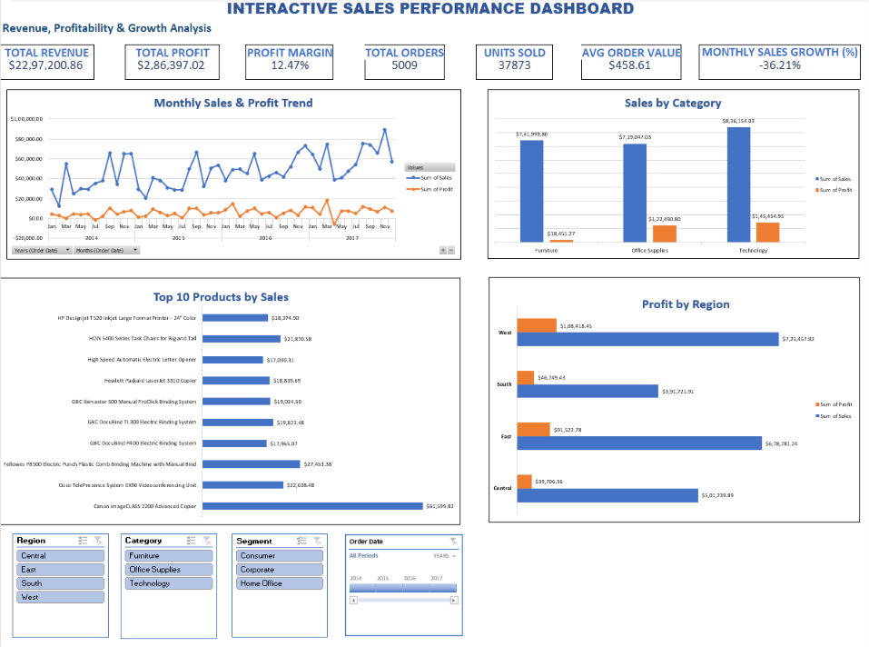
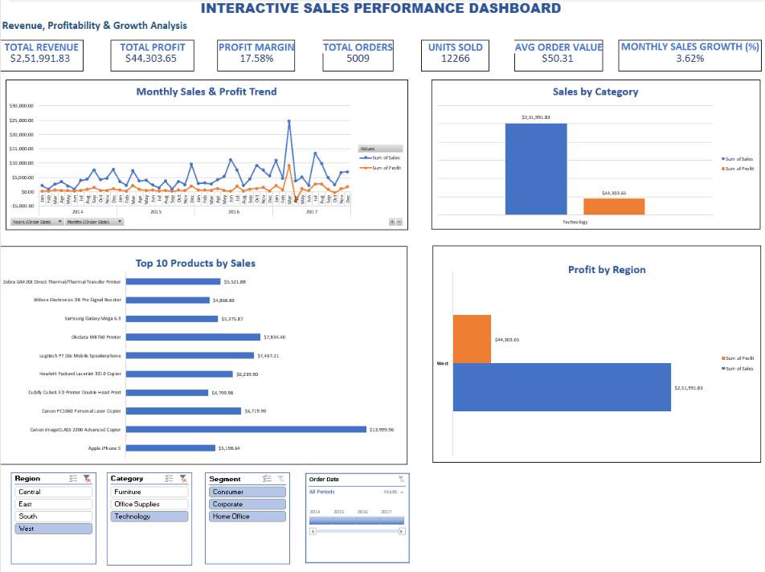

# Interactive Sales Performance & Profitability Analytics

## 📌 Project Overview
This project analyzes retail sales data to identify sales trends, profitability, top-performing products, and underperforming regions using **Microsoft Excel and SQL Server**.

## 🎯 Project Objectives
- Analyze overall sales, profit, and order performance.
- Identify monthly sales trends and growth.
- Compare performance across categories, regions, and customer segments.
- Identify top-selling and loss-making products.
- Generate actionable business recommendations.

## 🛠️ Tools & Technologies
- Microsoft Excel 2021
- SQL Server Management Studio (SSMS)

## 📊 Part 1: Excel Dashboard & Analysis
Excel was used to clean and analyze retail sales data and build an interactive dashboard.

**Key Features:**
- KPI cards for sales, profit, orders, and other metrics.
- PivotTables and PivotCharts.
- Interactive slicers and timeline filters.
- Category, regional, segment, and product performance analysis.
- Business insights and recommendations.

## 🗄️ Part 2: SQL Sales Analysis
SQL Server was used to query the cleaned retail sales dataset and perform data quality checks and business analysis.

**Key Analysis:**
- Data quality checks for missing values, duplicates, and invalid records.
- Total sales, profit, quantity, and distinct order calculations.
- Monthly sales and profit trends.
- Category and regional performance.
- Top 10 products by sales.
- Loss-making product analysis.
- Month-over-month sales growth.
- Discount and profitability analysis.

## 📈 Business Value
This project demonstrates how Excel dashboards and SQL queries can work together to turn raw retail data into useful business insights, support decision-making, and identify opportunities to improve profitability.

## 👨‍💻 Skills Demonstrated
Excel, Data Cleaning, PivotTables, PivotCharts, Dashboard Design, SQL Queries, Aggregations, GROUP BY, CTEs, Window Functions, Data Quality Checks, Business Analysis, and Data Visualization.

## 📸 Dashboard Screenshots

### Interactive Sales Dashboard

### Interactive Filters

